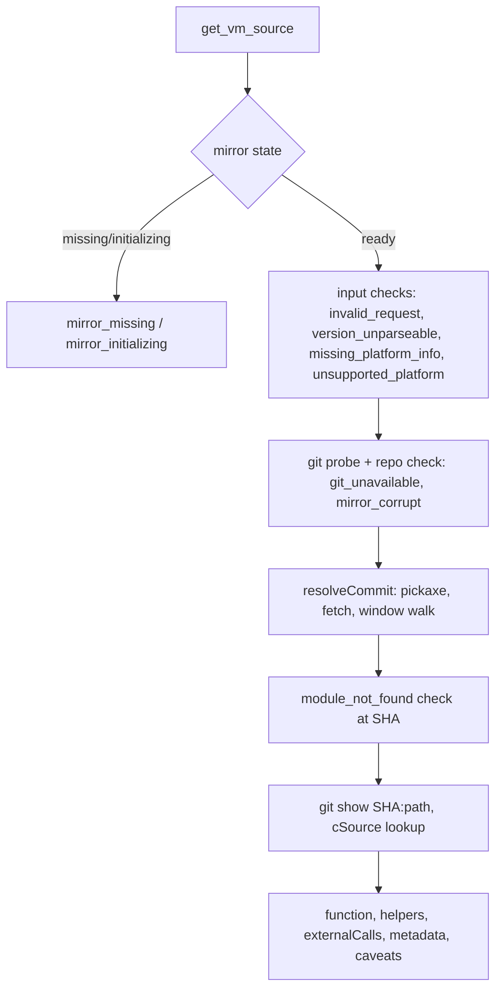

# VM Source: Primitive Lookup — Technical Spec

## Context

Behavior is specified in `functional-spec.md` (52 numbered invariants, cited below as "inv N").
Design research and measurements are in `initiative.md`; this plan builds on it and doesn't
repeat it.

The bridge is two halves joined by the NDJSON protocol in `mcp-bridge/PROTOCOL.md`:

- **Cuis side** — `mcp-bridge/image/MCP-Bridge.pck.st`. `McpBridgeConnection>>operationHandlers`
  (lines 97–110) maps wire `op` strings to handler selectors, consulted by `requestLoop`
  (65–95). Handlers pull params with `paramNamed:from:` (262) and answer via `sendSuccess:`
  (272) / `sendError:message:` (283). `protocolVersion` is `^ 2` (50–52). An unknown `op` is
  answered `invalid_request` (line 85), which is why the version must be bumped (inv 44).
- **Bridge process** — `mcp-bridge/server/src/`. `tools.ts` is a table (`TOOL_METADATA`, 23–114)
  plus one generic handler that forwards `args` to `client.sendRequest(meta.name, args)`
  (126–145) and formats failures as `"<code>: <message>"` for any `Error` with a `code`
  (`hasErrorCode`, 117). `index.ts` builds its tool list from `createTools(client)` and has no
  hardcoded count, so it needs no change. `protocol.ts` holds `PROTOCOL_VERSION = 2` (line 13),
  the six wire `ErrorCode`s (16–22) and the per-op types/union (122–131). `cuisClient.ts` is
  generic over `op` and unchanged.
- **Nothing host-side exists yet**: no git, filesystem or subprocess code in the server.
  Dependencies are only `@modelcontextprotocol/sdk`; tests are vitest (`npm test`) and SUnit
  (`Tests-MCP-Bridge.pck.st`, `tools/run-headless-tests.sh`).
- **Upstream layout confirmed** in a local checkout (shape only, never read at runtime):
  `primitiveTable[MaxPrimitiveIndex + 2]` at `spur64.cog/cointerp.c:2062` with
  `/* N */ value,` rows; `vm_exports[][3]` at `:84252` (`static char _m[] = ""`); rows like
  `{(void*)_m, "primitiveAddLargeIntegers\000\000\001", (void*)primitiveAddLargeIntegers}`;
  functions as `\t/* Class>>#sel */` / return-type line / `name(args)` / `{`, ending at a
  column-0 `}`; `moduleName` stamps as `static const char *moduleName = "SocketPlugin
  VMMaker.oscog-eem.3743 " INT_EXT;`. The quick-primitive dispatcher
  `externalQuickPrimitiveResponse` is at `:67245`. That checkout is a depth-1 clone, so it can't
  serve as a history fixture.

## Proposed changes

Two independent slices that meet only in `tools.ts`.

### Slice A — Cuis-side tools (4 wire ops, protocol 2 → 3)

- `PROTOCOL.md` first: add `get_vm_version`, `get_platform_name`, `get_platform_subtype`
  (params `{}`, result string) and `get_loaded_modules` (result `{"builtin": string[],
  "loaded": string[]}`); "9 operations" → 13; `PROTOCOL_VERSION = 3`. The six wire error codes
  don't change; the new host-side codes are not wire codes.
- `protocol.ts`: constant → 3; add param/result types and union members.
- `MCP-Bridge.pck.st`: `protocolVersion ^ 3`; four handlers added to `operationHandlers`, each
  one line in the existing shape, answering `Smalltalk vmVersion asString`, `platformName`,
  `platformSubtype`, and an `OrderedDictionary` of `'builtin' → listBuiltinModules`,
  `'loaded' → listLoadedModules` (each `asArray` of `asString`). Read-only by construction (inv 47);
  update the class comment.
- `tools.ts`: four `TOOL_METADATA` entries (no-arg schema, same as `list_categories`). They flow
  through the existing generic handler, so `unreachable`, `protocol_mismatch` and `session_busy`
  behave as for every existing tool (inv 44, 45).
- `.claude/skills/run-cuis-mcp-bridge/driver.mjs:20` hardcodes `PROTOCOL_VERSION = 2`; its own
  SKILL.md (line 120) warns about this drift, so bump it.

### Slice B — host-side tools (`mcp-bridge/server/src/vmSource/`)

Own folder, because these handlers never touch `CuisClient` (inv 46) and therefore don't fit
the forwarding table. `createTools(client)` returns the 13 forwarded tools followed by
`createVmSourceTools()`. `tools.ts` also exports its error-formatting catch body as
`errorResult(err)` so both groups format failures identically.

| File | Responsibility |
|---|---|
| `errors.ts` | `VmSourceError(code, message)` and the host-side code union. It is separate from the wire `ErrorCode` and carries `.code`, so it formats as `"<code>: <message>"`. |
| `git.ts` | `GitRunner`: `execFile('git', args)` with no shell, `LC_ALL=C`, `GIT_TERMINAL_PROMPT=0`, `maxBuffer` 64 MB (`cointerp.c` is several MB), per-call timeout. Always passes `--git-dir=<mirror>`. Maps `ENOENT`/`EACCES` to `git_unavailable`. `classifyGitError(stderr)` returns `network` / `lock` / `corrupt` / `other`. The runner is injectable (tests). |
| `lookupPlan.ts` | Pure functions: input validation in inv 31's order, `vmVersion` parsing (token via `/VMMaker\.oscog-eem\.(\d+)/`, family tag via `/^Open Smalltalk (.+?) VM \[/`), platform tables, path derivation, default flags. |
| `cSource.ts` | Pure functions over file text: function index, `_exports`/`vm_exports` lookup, `primitiveTable` lookup, helpers, external calls, `moduleName` stamp. |
| `mirror.ts` | Mirror state, `setupVmMirror`, lock/error files, background clone. |
| `resolveCommit.ts` | Pickaxe search, window walk, fetch with retry. |
| `getVmSource.ts` | Orchestration, response and caveat assembly. |
| `tools.ts` | The two `ToolDefinition`s (descriptions, schemas, handlers). |

`createVmSourceTools(opts?: {home, upstreamUrl, git, sleep})` defaults to
`~/.cuis-mcp-bridge` and `https://github.com/OpenSmalltalk/opensmalltalk-vm.git`; the options
exist so tests run against a temp home and a local upstream, not as user configuration.

**Mirror (`mirror.ts`, inv 24–30, 48, 49, 51).**
Paths: `vm-mirror`, `vm-mirror.lock`, `vm-mirror.error`, `vm-mirror.tmp-<pid>` under `home`.
Every write goes through a helper that throws if the path isn't inside `home`.

- `state()`: `vm-mirror` exists → `ready`; else a live lock → `initializing`; else `missing`
  (a stale lock or an error file reads as `missing`; `get_vm_source` cleans nothing).
- The lock holds `{pid, startTime}`, with `startTime` from `ps -o lstart= -p <pid>`. It is stale
  if the pid is dead or its current start time differs (PID reuse, inv 29). It is created by
  writing a private temp file and `link()`ing it to `vm-mirror.lock`: `EEXIST` means someone
  else won, and the content is never observable half-written (inv 28).
- `setupVmMirror()` runs in this order: ready → `ready`; error file → report its
  `{code, message}`, delete it, start nothing; live lock → `in_progress`; stale lock → take
  over (rename to `.stale-<pid>`, re-read, delete only if the content is still the stale one,
  otherwise `link` it back and answer `in_progress`), remove `vm-mirror.tmp-*`, continue; check
  git (`git_unavailable`); `mkdir -p home`; acquire the lock; spawn `git clone --bare
  <upstream> vm-mirror.tmp-<pid>`; return `started` without awaiting.
- The child's `close` handler: exit 0 → `rename(tmp, vm-mirror)` (atomic, inv 27), delete the
  lock. Non-zero → delete tmp, write the error file `{code, message}`, then delete the lock.
  Code is `fetch_failed` when `classifyGitError` says `network`, else `mirror_write_failed`
  (inv 30). The bridge kills the child on `process.exit`, so a clean exit leaves nothing running
  and a hard kill leaves a stale lock for the next call to take over.

**Commit resolution (`resolveCommit.ts`, inv 19–23, 32–34, 43).**
Inputs: token, optional `{pluginPath, liveEntries}`. Pickaxe:
`git log Cog --reverse --format=%H -S'VMMaker.oscog-eem.<N>]' -- 'src/*/cointerp.c' 'src/*/interp.c'`
→ `[introducing, replacing?]`. The trailing `]` prevents `.3738` matching `.37380`; `N` is
digits only and the args go through `execFile`, so there's no injection surface.

1. Empty result → fetch `origin +refs/heads/Cog:refs/heads/Cog` once, search again; still
   empty → `commit_not_found`.
2. Default pick: `introducing` (inv 20).
3. With `module` + `moduleStamps`: read `moduleName` at `introducing` to get the plugin's
   name. No live entry with that first word → `not_verifiable`, keep `introducing`, no fetch.
   Otherwise walk the window (`introducing`, then `git rev-list --reverse --first-parent
   introducing..<replacing>^`, or `..Cog` when nothing replaces it), reading `git show
   <sha>:<path>` per commit, and pick the oldest whose stamp equals a live entry (live entry
   minus ` (i)`/` (e)`, file stamp trimmed). A missing file counts as no match. No match →
   one refresh (fetch, re-run pickaxe, re-walk). Still none → `introducing` and a `mismatch`
   carrying both stamps.
4. Fetch errors are classified: `network` → `fetch_failed` (inv 43, including the refresh in
   step 3); `lock` → retry, with sleeps of 500/700/1000/1400/2000 ms, each retry re-running
   the pickaxe before fetching again, then `mirror_busy` (inv 34); anything else →
   `mirror_write_failed` (inv 33). An initial `git rev-parse --verify refs/heads/Cog^{commit}`
   whose stderr is `corrupt` maps to `mirror_corrupt` (inv 40).

**Path derivation and lookup plan (`lookupPlan.ts`, inv 8–9, 14–16, 38–39).**

- Module given, ordinary: `src/plugins/<M>/<M>.c`. After resolution, `<M>` must be an entry of
  `git ls-tree <sha> src/plugins/` or the result is `module_not_found` (inv 31.4). Paths are only
  built from `^[A-Za-z0-9_]+$` names, so a hostile `module` can't reach git as a path.
- `SqueakFFIPrims`: one constant table `(platformName, platformSubtype) → file`. The macOS rows
  (`x64` → `X64SysVFFIPlugin.c`, `aarch64` → `ARM64AppleFFIPlugin.c`) are verified; `unix`
  rows (`x64` → `X64SysVFFIPlugin.c`, `aarch64` → `ARM64FFIPlugin.c`) come from filenames and are
  marked unverified in a comment. Anything else → `unsupported_platform`.
- Module omitted: family `Cog[Spur]` + width (`x64`/`aarch64` → 64; `intel`/`powerpc` → 32) →
  `spur64.cog`/`spur32.cog`; `Cog[SqueakV3]` → `v3.cog`. File `cointerp.c`, or
  `gcc3x-cointerp.c` when `platformName` is given and is `Mac OS` or `unix`. The "cog default"
  flag is set only for the Spur families, where `lowcode`/`sista` siblings exist. `v3.cog` has
  none, so nothing is defaulted there.
- `Win32` → `unsupported_platform` whenever supplied, ahead of everything else in that check.

**C source reading (`cSource.ts`, inv 12, 16, 18, 35–37).** A single pass builds a function
index: a column-0 `name(` line whose next line starts with `{` and whose line two above is
`\t/* …>>#… */`. Start is that comment line and end is the next column-0 `}`. The layout was
checked across all 136 `src/` files at `759d8f204` (initiative.md).

- Named key: scan rows `{(void*)_m, "<key>(\000…)?", (void*)<fn>}` in any `*_exports` /
  `vm_exports` array, which covers `<Module>_exports`, `ARM64AppleFFIPlugin_exports` and
  `vm_exports` with no array-name guessing. No row → `symbol_not_found`.
- Numbered key: parse `primitiveTable` rows. Missing slot → `symbol_not_found`; `(void
  (*)(void))0` → `primitive_slot_empty` naming the slot; `(void (*)(void))K` with K ≤ 519 →
  `externalQuickPrimitiveResponse`, marked shared with the branch for N (256 self, 257 true,
  258 false, 259 nil, 260–263 SmallInteger N−261, ≥264 inst var N−264, read off the dispatcher
  body above); slot 117 → `primitiveExternalCall`, marked shared.
- `helpers`: identifiers followed by `(` in the body, with comments, strings and `#` lines
  stripped, intersected with the index, in first-appearance order. One level, no cap.
- `externalCalls`: remaining called names, minus C keywords, ALL_CAPS names and file-local
  `#define name(` macros. A name with a `(*name)(` declaration in the file is `vm_interface`;
  the rest are `platform_code_unavailable`. If a libc call shows up in a fixture, add it to an
  ignore list rather than loosening the rule.
- `moduleName` stamp: regex on `static const char *moduleName = "…"`.

**Response (`getVmSource.ts`).** Field names aren't fixed by the functional spec, so:

```ts
interface VmSourceResult {
  function: string;  generatedFrom: string;
  helpers: { name: string; source: string }[];
  externalCalls: { name: string; kind: 'vm_interface' | 'platform_code_unavailable' }[];
  metadata: {
    commit: string; path: string; lines: { start: number; end: number };
    dispatch: { kind: 'exports' | 'primitiveTable'; entry: string };
    shared?: { reason: 'quick_primitive' | 'external_call'; applies: string };
    defaults: ('cog_variant' | 'plain_rendering')[];
    rendering?: 'plain' | 'gcc3x';
    moduleStampCheck?: { result: 'match' | 'mismatch' | 'not_verifiable';
                         running?: string; source?: string };
  };
  caveats: string[];
}
```

`caveats` is built from the same facts, one sentence per applied default or raised warning, and
`[]` otherwise. The handler returns `JSON.stringify(result)` as text, as the existing tools do.
The `get_vm_source` description tells the assistant to state the caveats and never present a
defaulted source as the exact compiled one. Argument types are checked in the handler, because
`index.ts` forwards arguments unvalidated. A missing or mistyped argument is
`invalid_request`, which is a gap-fill because the spec only names two `invalid_request` cases.



### Tradeoffs

- **Shell out to `git` vs. a JS git library**: shell out. Pickaxe and `ls-tree` are one-liners
  there, there are no new dependencies, and `git_unavailable` is a single clear failure.
- **Clone as a child of the bridge vs. a detached process**: child plus lock with start time.
  A detached clone would outlive its owner and need adoption logic; inv 29 asks for interrupted
  clones to be discarded.
- **Line scanner vs. a C parser**: line scanner. The generator's layout is regular and was
  verified on every function; a parser would be heavy for a one-level helper scan.
- **Stale-lock takeover**: rename-and-verify, not a second lock. A residual window remains where
  two takeovers interleave with a fresh acquisition; it's noted under risks.

## Implementation sequence

1. `mcp-bridge/PROTOCOL.md` — four ops, 13-op wording, `PROTOCOL_VERSION = 3`
2. `mcp-bridge/server/src/protocol.ts` — version 3, param/result types, union members
3. `mcp-bridge/image/MCP-Bridge.pck.st` — `protocolVersion ^ 3`, four handlers, `operationHandlers`, class comment
4. `mcp-bridge/image/Tests-MCP-Bridge.pck.st` — SUnit tests for the four ops and handshake at v3
5. `.claude/skills/run-cuis-mcp-bridge/driver.mjs` — `PROTOCOL_VERSION = 3`
6. `mcp-bridge/server/src/tools.ts` — four `TOOL_METADATA` entries, exported `errorResult`; extend `tools.test.ts` and add a handshake-sends-3 test in `cuisClient.test.ts`
7. `mcp-bridge/server/src/vmSource/errors.ts` — `VmSourceError` and code union
8. `mcp-bridge/server/src/vmSource/git.ts` — `GitRunner`, `classifyGitError` (+ `git.test.ts`)
9. `mcp-bridge/server/src/vmSource/lookupPlan.ts` — validation order, version parsing, platform tables, path derivation (+ `lookupPlan.test.ts`)
10. `mcp-bridge/server/src/vmSource/cSource.ts` — function index, exports/primitiveTable lookup, helpers, external calls, stamp (+ `cSource.test.ts` with synthetic C fixtures)
11. `mcp-bridge/server/src/vmSource/testSupport/fakeUpstream.ts` — builds a local git upstream with scripted commits (token windows, title/content mismatch, stamp changes)
12. `mcp-bridge/server/src/vmSource/mirror.ts` — state, lock, background clone, `setupVmMirror` (+ `mirror.test.ts`)
13. `mcp-bridge/server/src/vmSource/resolveCommit.ts` — pickaxe, window walk, fetch retry (+ `resolveCommit.test.ts`)
14. `mcp-bridge/server/src/vmSource/getVmSource.ts` — orchestration, response, caveats (+ `getVmSource.test.ts`)
15. `mcp-bridge/server/src/vmSource/tools.ts` — `setup_vm_mirror` / `get_vm_source` definitions, wired into `createTools` (+ tests)
16. `mcp-bridge/server/src/vmSource/golden.test.ts` — opt-in live checks against a real mirror
17. `mcp-bridge/README.md` and root `README.md` — 15 tools, `~/.cuis-mcp-bridge`, `setup_vm_mirror` first-use note, host-side error codes

## Testing and validation

Unit and integration tests are hermetic: a temp `home` and a local git upstream built by
`fakeUpstream.ts`, with synthetic `cointerp.c` / plugin fixtures in the real generated shape.
An injected `GitRunner` records argv and can fail on demand; an injected `sleep` makes backoff
instant.

| Invariants | Verified by |
|---|---|
| 1–5, 44, 45, 47 | SUnit, one test per op in the existing raw-socket style: the result equals the live `Smalltalk` value; `get_loaded_modules` returns exactly `builtin` and `loaded` string arrays; a second call after loading a module differs; image state is unchanged after calls. A handshake with version 2 gets `protocol_mismatch` (the message names the reload). vitest: handshake sends 3; a fake server that rejects it surfaces `protocol_mismatch` through the tool handler; `unreachable` is unchanged. |
| 6, 24–30 | `mirror.test.ts` against a local upstream: states missing → initializing → ready; `ready` makes no git call; five concurrent `setupVmMirror` calls on two services sharing a home give one `started` and four `in_progress`; a lock with a dead pid, and a lock with the live pid but a different start time, are both taken over (inv 29); a half-finished `vm-mirror.tmp-*` is never ready (inv 27); failures: a bad upstream gives `fetch_failed` once, then the retry starts, and an unwritable home gives `mirror_write_failed` (skip when root), both carrying git's text. |
| 7–11, 46 | `getVmSource.test.ts` calls it with no Cuis-side tool run first; a fake client whose `sendRequest` throws is never invoked, and `session_busy` never appears. |
| 12–13, 35–37 | Fixture lookups assert every response field. The returned source's line count is far below the file's, and a commit that later changes the file doesn't change the answer for the earlier SHA. Error cases: `path_not_found` (a commit lacking the layout), `symbol_not_found` (including `"1"` as a string name, and an out-of-range number), `primitive_slot_empty` (slot 0 or 520). |
| 14–16, 18, 38–39 | Table-driven `lookupPlan.test.ts` and fixtures: `cog` default flagged for Spur but not V3; plain vs. `gcc3x-` with and without `platformName`; `SqueakFFIPrims` picks `ARM64AppleFFIPlugin.c` over a decoy `SqueakFFIPrims.c` with no exports; quick primitive 264 and slot 117 return the shared dispatcher with `applies`; Stack VM works with `module` and gives `unsupported_platform` without; `Win32` is rejected even for an ordinary plugin; unknown `platformName` / `platformSubtype` is ignored when unused. |
| 17, 20, 22 | `resolveCommit.test.ts` windows: oldest introducing commit by default; oldest stamp-matching commit with stamps; `match` / `mismatch` (both stamps) / `not_verifiable` (argv shows no fetch); stale mirror, where the matching commit exists only upstream: exactly one fetch, then it is found; none after the refresh falls back to `introducing` with `mismatch`; stamps absent or `module` omitted: `moduleStampCheck` absent. Commit already local: argv contains no `fetch`. |
| 19, 21, 23, 32, 33, 42, 43 | A commit whose title names a different revision than its content resolves by content; `.3738` doesn't match `.37380`; the same inputs twice give an identical response; missing locally → one fetch then success; fetch succeeds but nothing matches → `commit_not_found`; unreachable upstream → `fetch_failed` for both the initial fetch and the stamp refresh, never `commit_not_found`; the recorded argv shows only `clone` / `fetch` touch the network, and no other host-side tool or module spawns anything. |
| 31 | Table-driven order test: inputs carrying several faults at once report the first by inv 31's order, and `mirror_missing` / `mirror_initializing` beat invalid inputs. `module_not_found` fires after resolution and before any file read. |
| 34 | The injected runner fails the fetch with a `Unable to create '….lock'` error N times: success after a retry; backoff recorded as 500/700/1000/1400/2000; `mirror_busy` after the fifth; the pickaxe is re-run before each re-fetch. |
| 40, 41 | An empty `vm-mirror/` directory gives `mirror_corrupt` with the delete-and-`setup_vm_mirror` message while `setup_vm_mirror` still says `ready`, and nothing is deleted. A runner throwing `ENOENT` gives `git_unavailable` from both tools, and `setup_vm_mirror` doesn't return `started`. |
| 48–51 | argv log: every call carries `--git-dir=<home>/vm-mirror`, none of `checkout`, `worktree`, `reset`, `update-ref` or `symbolic-ref` appears, and no argv or fs path mentions a project `opensmalltalk-vm/`. The `home`-rooted write guard throws if anything escapes `home`. Two services sharing a home reuse one mirror. |
| 52 | `Promise.all` of mixed same/different `get_vm_source` calls equals the sequential results; concurrent calls needing a fetch all succeed (one fetch proceeds, the rest retry). |
| 12 (tool text) | The `get_vm_source` description is asserted to instruct stating the caveats. |

`golden.test.ts` is skipped unless `VM_SOURCE_LIVE=1` and the real mirror contains
`759d8f204`. It then checks, read-only, the examples in `initiative.md`: `primitiveAdd` via
`<primitive: 1>` with `stackIntegerValue` under `helpers`; `primitiveSocketReceiveDataAvailable`
with `sqSocketReceiveDataAvailable` as unavailable platform code; `primitiveImageFormatVersion`
via `vm_exports`; `primitiveCalloutWithArgs` in `ARM64AppleFFIPlugin.c`. The end-to-end check
for the whole feature is a run through the `run-cuis-mcp-bridge` skill driver: the four new ops
against a live image.

## Risks and mitigations

- **Latency.** The pickaxe costs about 5–7 s per lookup with no token → SHA cache, and a miss
  adds a fetch and a second search (~14 s). The MCP client timeout is unknown. Mitigation: the
  mirror is built ahead by `setup_vm_mirror`. A cache is safe to add later (follow-up).
- **Parser assumptions** (column-0 `}`, comment above the signature, export-row shape) were
  verified only at `759d8f204`. A future VMMaker output change would give `symbol_not_found` or
  a short function. The golden test and the synthetic fixtures are the tripwire.
- **Error classification by git stderr text.** `LC_ALL=C` pins the language; unrecognized text
  becomes `mirror_write_failed`, so a local fault is never labelled as a network one (inv 33).
  The pattern list lives in one table with a test per entry.
- **Orphaned clone after a hard kill** keeps writing into `vm-mirror.tmp-<oldpid>` until the next
  `setup_vm_mirror` deletes it. The new clone uses its own pid directory, so they never share a
  path.
- **Stale-lock takeover** can still misfire if two takeovers interleave with a third caller's fresh
  acquisition. The worst case is a duplicate background clone into a different tmp directory;
  the first `rename` wins, and the loser's rename fails and is discarded.
- **Platform tables** are verified for macOS only (inv 39 makes everything else a clean
  `unsupported_platform`). Linux `platformSubtype` spellings need a live check before the `unix`
  rows are trusted.
- **Large responses.** `helpers` has no cap (inv 12). A core-interpreter primitive with many
  helpers can be big; accepted by the spec.

## Follow-ups

- Token → SHA cache; `--single-branch` clone measurement (both noted in `initiative.md`).
- Linux / Windows platform mappings, and Stack VM support (`TODO.md`: `vm-source-stack-vm`).
- Platform code behind `externalCalls` (`TODO.md`: `vm-source-platform-paths`).
